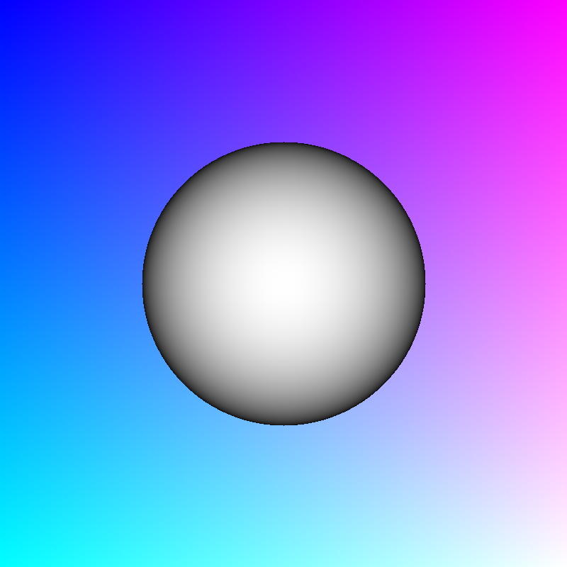

# Patina

> _Patina_
>   - a usually green film formed naturally on copper and bronze by long exposure
>     or artificially (as by acids) and often valued aesthetically for its color
>   - a surface appearance of something grown beautiful especially with age or use

Patina is a physically based renderer written in Rust. I chose the name
_Patina_ as it's similar in spirit to _rust_ and _oxidation_.

I'd like to learn how to implement physically based rendering techniques. I'll
be following along to the
[PBR-book](https://pbr-book.org/4ed/Introduction/Literate_Programming#fragment-InitializeGlobalVariables-0),

I'll be implementing this in Rust - because why not - and I don't know at what
point I'll consider Patina done / feature complete.

I'll try to keep a small dev-log over at [./devlog], in case you want to follow
along.

## Development setup

You need a [rust compiler](https://rustup.rs/), and the
[`just`](https://github.com/casey/just) program runner (similar to makefiles).

## Examples

Each milestone is a separate example in [`./examples`](./examples), and its render is stored in
[`./renders`](./renders). Older milestones are kept, so they keep compiling (and rendering) as the
library evolves. Render one with `just render <name>`, or all of them with `just render-all`.

| Render | Milestone |
|---|---|
|  | **01: Gradient.** An orthographic camera generating a ray per pixel, colored by where the ray starts on the screen. |
|  | **02: Orthographic spheres.** First render up, using the orthographic camera, as it's the simplest conceptually. Two spheres of the same size, shaded by depth on a shared scale, with the far one twice as far away. The orthographic projection shows them at the same size: no foreshortening. Still no light transport, and no general shape-ray intersections. |
|  | **03: Perspective spheres.** Second render up, using the perspective camera. Two spheres of the same size, shaded by depth on a shared scale, with the far one twice as far away. The perspective projection shows how the scale differs based on distance to camera. | 
